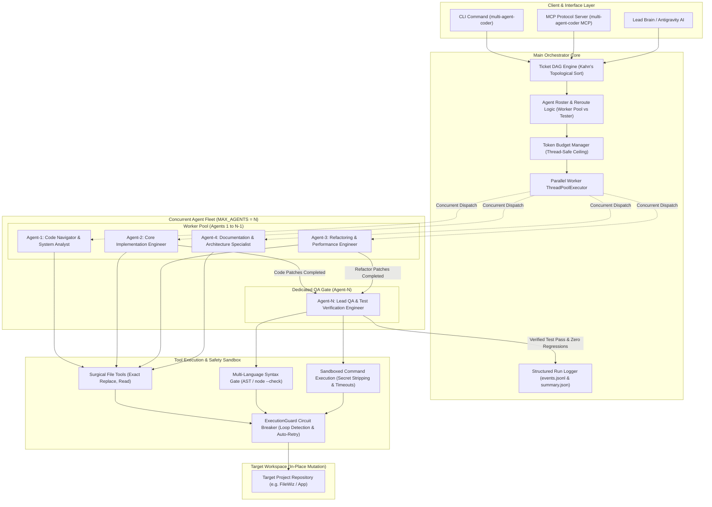
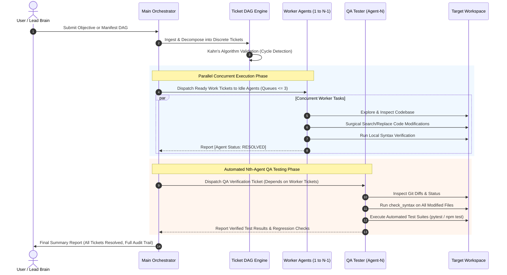

# Multi-Agent Coder

[](https://python.org)
[](https://ai.google.dev/)
[](https://github.com/googleapis/python-genai)
[](https://www.trychroma.com/)
[](https://github.com/Textualize/rich)
[](https://docs.pytest.org/)

An enterprise-grade, fault-tolerant concurrent multi-agent engineering system powered by **Google Gemini** (`gemini-2.5-flash-lite` via `google-genai`). Features DAG dependency orchestration, multi-threaded parallel agent execution, dedicated Nth-agent QA verification, Git worktree isolation, surgical atomic code editing, sandboxed execution with secret stripping, circuit-breaker guards, and an automated verification test suite.

---

## System Architecture



---

## End-to-End Operational Workflow



### Detailed Workflow Stages

1. **Objective Ingestion & DAG Decomposition**:
   - The user or Lead Brain passes an objective (e.g. `--objective "Optimize database & add benchmarks"`) or a structured manifest DAG (`--manifest path/to/dag.json`).
   - The Orchestrator decomposes the problem into discrete technical tickets (`analysis`, `coding`, `refactor`, `testing`).
   - Dependencies are validated with **Kahn's topological sort** to eliminate cycles upfront.

2. **Parallel Scheduling & Dynamic Dispatching**:
   - Tickets with satisfied prerequisites enter the dispatch queue.
   - The Orchestrator enforces a strict per-agent queue limit of 3.
   - Ready tickets are routed dynamically across idle worker agents (`queue_size == 0`) to maximize fleet concurrency.
   - Work tickets execute in parallel using multi-threaded execution (`ThreadPoolExecutor`).

3. **In-Place Surgical Editing & Sandboxed Tools**:
   - Agents operate directly within the target workspace without creating duplicate repos.
   - File edits use strict context-anchored search/replace patterns with duplicate block rejection.
   - Every file change is immediately validated by the syntax checker (`node --check` for JS, `ast.parse` for Python).
   - `ExecutionGuard` prevents infinite tool loops and automatically retries transient API errors.

4. **Nth-Agent QA Verification & Reporting**:
   - For an agent pool of size $N$ (e.g., 5 agents): Agents 1 to $N-1$ (Agents 1-4) execute implementation tasks, while Agent $N$ (Agent-5) is strictly reserved as the **Lead QA & Test Verification Engineer**.
   - Completed code changes trigger an automated QA ticket for Agent $N$.
   - Agent $N$ runs regression test suites (`pytest`, `npm test`, `node tests/e2e.test.js`) and reports pass/fail verification logs directly to the Orchestrator.

---

## Unified Repository Layout

```
Multi-Agent-Coder/
├── pyproject.toml              # Unified package configuration & pytest settings
├── uv.lock                     # Unified lockfile
├── .env.example                # Example environment variables
├── src/
│   └── multi_agent_coder/      # Core source package
│       ├── __init__.py
│       ├── cli/                # Consolidated CLI subcommands (navigator, orchestrator, harness)
│       │   ├── __init__.py
│       │   ├── __main__.py     # Unified entrypoint: multi-agent-coder <subcommand>
│       │   ├── navigator.py    # Codebase Navigator agent
│       │   ├── orchestrator.py # Multi-agent ticket orchestrator
│       │   └── harness_demo.py # Pluggable LLM harness demo
│       ├── common/             # logging_config.py, menu.py, token_tracker.py (ExecutionGuard), ui.py
│       ├── harness/            # adapters.py, base.py, engine.py, ticket_runner.py, types.py
│       ├── indexer/            # chunker.py, embedder.py
│       ├── orchestrator/       # agent_worker.py, dashboard.py, main_orchestrator.py, ticket.py (TicketDAG)
│       ├── store/              # memory.py, vector.py
│       └── tools/              # coding.py (atomic patch), execution.py (sandboxed), files.py, repo.py (worktree)
└── tests/                      # Dedicated pytest test suite (29 tests)
    ├── conftest.py
    ├── test_dag_orchestrator.py
    ├── test_surgical_coding.py
    ├── test_sandbox_execution.py
    ├── test_harness_circuit_breaker.py
    ├── test_worktree_isolation.py
    ├── test_ticket_system.py
    ├── test_harness.py
    └── test_e2e_tools.py
```

---

## Threat Model & Failure Mode Mitigations

| Subsystem | Threat / Failure Mode | Hardened Mitigation |
| :--- | :--- | :--- |
| **Orchestrator** (`ticket.py`, `main_orchestrator.py`) | Circular dependencies, deadlocks, hanging child tasks | **Kahn's topological sort** on ticket ingestion rejects cycles immediately. Downstream tickets transition to `BLOCKED` if any dependency fails. |
| **Concurrency** (`agent_worker.py`, `tools/repo.py`) | Race conditions & dirty working trees between agents | **Git Worktree Isolation**: Each ticket runs in `.worktrees/ticket-<id>` on its own branch (`agent/ticket-<id>`). Startup auto-prunes stale worktrees. |
| **Code Editing** (`tools/coding.py`, `tools/files.py`) | Path traversal attacks, hallucinated line numbers, broken syntax | Strict **SEARCH/REPLACE** exact matching, workspace root boundary check (`is_relative_to`), in-memory Python AST validation (`ast.parse`), and atomic write via tempfile + `os.replace`. |
| **Execution** (`tools/execution.py`) | Zombie processes, hanging input prompts, context window overflow | `stdin=subprocess.DEVNULL`, process-group isolation, secret stripping (`API_KEY`, `TOKEN`, `PASSWORD`), hard timeouts with process tree termination, and output head/tail truncation. |
| **Harness & Spend** (`harness/engine.py`, `token_tracker.py`) | Infinite tool loops, rate limits, runaway token cost | **ExecutionGuard Circuit Breaker**: State-hash deduplication trips after 3 identical tool calls. Hard token budget ceiling aborts execution if spend limit reached. |

---

## Quickstart & CLI

### 1. Installation
```bash
# Clone the repository
git clone https://github.com/sRiSh-JaNa-tech/Multi-Agent-Coder.git
cd Multi-Agent-Coder

# Install in editable mode
pip install -e .
```

### 2. Configure Environment
```bash
cp .env.example .env
# Set your GEMINI_API_KEY and MAX_AGENTS=3
```

### 3. Run Subcommands via Unified CLI
```bash
# Launch Codebase Navigator
multi-agent-coder navigator

# Launch Multi-Agent Ticket Orchestrator
multi-agent-coder orchestrator

# Launch LLM Testing & Execution Harness Demo
multi-agent-coder harness
# Or run non-interactive automated harness demos:
multi-agent-coder harness --all
```

---

## Automated Pytest Verification Suite

Run all 69 automated tests across DAG orchestration, parallel execution, Nth-agent QA verification, surgical coding, sandboxed execution, worktree isolation, and circuit breakers:

```bash
pytest tests/ -v
```

### Test Suite Coverage (69 Tests):
- `tests/test_parallel_and_tester.py`: Multi-threaded parallel execution concurrency overlap, dedicated Nth-agent QA tester designation (Agent-5 when `MAX_AGENTS=5`), automated QA verification ticket generation.
- `tests/test_swarm_controls.py`: Environment variable controls (`MODEL_NAME`, `TOKEN_USAGE_LIMIT`, `TARGET_WORKSPACE`), thread-safe token budget enforcement, git push worker guard, honest failure reporting.
- `tests/test_dag_orchestrator.py`: Cycle detection with Kahn's algorithm, missing dependency validation, downstream failure blocking.
- `tests/test_ticket_system.py`: Multi-agent FIFO queue execution, 3-ticket per agent strict queue limit, backlog dispatching.
- `tests/test_surgical_coding.py`: Path traversal protection, atomic file edits, syntax validation gates, duplicate block rejection.
- `tests/test_sandbox_execution.py`: Process timeout killing, secret stripping from environment, output head/tail truncation.
- `tests/test_harness_circuit_breaker.py`: Repeated identical tool call deduplication, token budget ceiling enforcement.
- `tests/test_worktree_isolation.py`: Isolated branch lifecycle, conflict-free parallel worktree editing and merge back to main.
- `tests/test_api_key_validation.py`: Secure API key acquisition, missing key rejection, mock environments.
- `tests/test_harness.py`: Mock, Callable, and Gemini adapter integrations.
- `tests/test_e2e_tools.py`: End-to-end tool registry operations.
- `tests/test_mcp_and_manifest.py`: MCP tool definitions, JSON manifest loading and validation.
