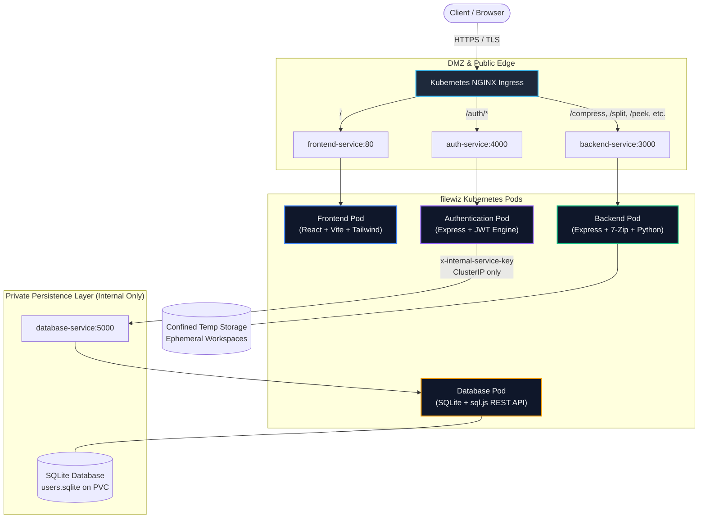
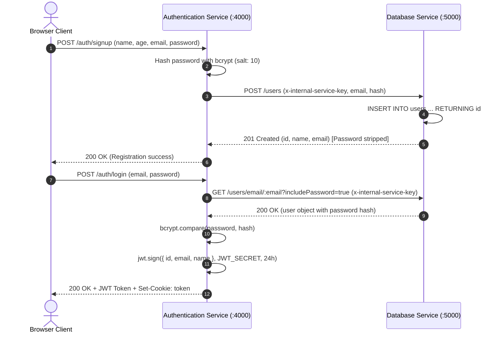
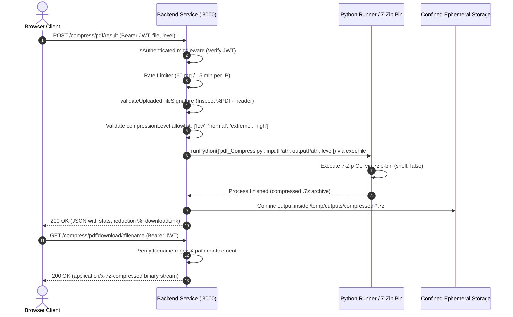

# FileWiz System Architecture

FileWiz is a containerized, decoupled microservices platform providing secure, high-performance file manipulation utilities—including 7-Zip PDF compression, archive inspection, document splitting, conversion, redaction, and encryption.

---

## 1. High-Level Architecture Overview

FileWiz follows a **Zero-Trust Microservices Architecture** deployed on Kubernetes. Services run in isolated pods with minimal inter-service trust, enforced by Kubernetes NetworkPolicies and cryptographic token validation.



---

## 2. Microservice Decomposition & Responsibilities

| Service | Technology Stack | Exposed Port | Ingress Path | Responsibility |
| :--- | :--- | :--- | :--- | :--- |
| **Frontend** | React 18, Vite, Tailwind CSS, TypeScript, Lucide | `80` (Nginx/Prod)<br>`5173` (Dev) | `/` | Responsive Single-Page Application (SPA), tool selection UI, 7-Zip options, auth modals, preview viewers. |
| **Authentication** | Node.js, Express, jsonwebtoken, bcryptjs, Helmet | `4000` (Prod)<br>`4001` (Test) | `/auth/*` | User registration, password hashing (10 salt rounds), JWT issuance/verification, admin debug gateways. |
| **Backend Core** | Node.js, Express, 7zip-bin, adm-zip, Python 3, Helmet | `3000` (Prod)<br>`3001` (Test) | `/compress/*`, `/split/*`, `/peek/*`, `/convert/*`, etc. | Compute-heavy file operations (7-Zip PDF compression, Python automation runners, safe ZIP inspection). |
| **Database** | Node.js, Express, SQLite (`sql.js`), Helmet | `5000` (Prod)<br>`5001` (Test) | *Internal Only (No Ingress)* | User persistence, email indexing, password storage. Strictly isolated to internal cluster networking. |

---

## 3. Data & Authentication Flow

### 3.1 User Registration & Login Sequence
Authentication state is mediated via stateless JSON Web Tokens (JWT) and HTTP-only session cookies. The database is shielded from direct public ingress.



### 3.2 Authenticated 7-Zip File Processing Pipeline
All compute endpoints require JWT validation and undergo binary magic byte verification before any processing engine runs.



---

## 4. Security Architecture & Threat Mitigations

FileWiz implements defense-in-depth across the application, runtime, and network layers:

| Vulnerability / Threat | CVSS | Layer | Implementation Details |
| :--- | :---: | :--- | :--- |
| **Remote Code Execution (RCE)** | 9.8 | Application | Deprecated `child_process.exec()`. Created `pythonRunner.js` which invokes `child_process.execFile()` with `{ shell: false }`. Arguments are passed as an array, eliminating shell interpolation. Strict input allowlists enforce regex schemas (`/^\d+(?:-\d+)?(?:,\d+(?:-\d+)?)*$/` for page ranges). |
| **Zip Slip (Path Traversal)** | 9.1 | Application | Custom `safeExtractZip()` in `peekRouter.js` verifies that every entry resolves strictly within the target sandbox using `path.resolve(base, entry).startsWith(base + path.sep)`. |
| **Zip Bomb (Denial of Service)** | 9.1 | Application | Extraction bounds: max 2,000 files, max 100 MB total uncompressed bytes, max 50 MB per file, and maximum decompression ratio of 50:1. |
| **Arbitrary File Exfiltration** | 8.6 | Application | `POST /split/pdf/download` strictly bounds packaging to `path.join(rootDir, 'temp', 'splits', jobId)`. Requests with relative traversals (`../`) or absolute paths outside the job sandbox are aborted with `403 Forbidden`. |
| **Static `/temp` Exposure** | 8.5 | Network / Ingress | Removed `express.static('/temp')` and deleted the `/temp` ingress route. Previews and downloads are gated through authenticated controller routes with strict workspace boundary checks. |
| **Credential & User Data Exposure** | 8.2 | Microservice | Database endpoints require `x-internal-service-key`. User serialization automatically strips `password` hashes on all standard reads. Debug endpoints in Auth are gated behind `requireAdmin`. |
| **Unauthenticated File Operations** | 7.5 | Application | Attached `isAuthenticated` across all heavy routes (`/compress/*`, `/split/*`, `/peek/*`, `/encrypt`, `/redaction`, `/convert`, `/repair`). Added `express-rate-limit` (60 req / 15 min). |
| **Permissive Cross-Origin Access** | 7.4 | Network | CORS explicitly whitelists only trusted origins (`FRONTEND_ORIGIN || http://localhost:5173`). Wildcard `origin: true` reflection with credentials is completely disabled. |
| **Hardcoded / Stale Secrets** | 7.5 | Orchestration | Removed plaintext production secrets from Git. Configured fail-closed runtime checks on boot: in production, apps terminate immediately if `JWT_SECRET` is unset, default, or `< 32` characters. |
| **Cookie Manipulation for Quotas** | 5.3 | Application | Free usage limits are stored and enforced server-side keyed by client IP in a 24-hour window, backed by HMAC-signed tamper-evident cookies. |
| **MIME Spoofing / Polyglot Attacks** | 6.5 | Application | Implemented `fileSignature.js` inspecting magic bytes (`%PDF-`, `PK\x03\x04`, `7z`, etc.) on uploaded streams before forwarding files to processors. Enforced 50 MB file size caps. |
| **Insecure HTTP Communication** | 6.5 | Ingress | Kubernetes Ingress enforces TLS termination, `ssl-redirect: "true"`, `force-ssl-redirect: "true"`, and HSTS security headers. `helmet()` is applied across all Express microservices. |

---

## 5. Kubernetes Deployment & Network Topology

The platform runs inside the `filewiz` namespace with declarative YAML manifests located in [`Deployment/`](file:///c:/Users/srish/Desktop/FileWiz/Deployment/):

```
Deployment/
├── 00-namespace.yaml          # Defines isolated 'filewiz' namespace
├── 01-config-secrets.yaml     # ConfigMaps and external secret references
├── 02-database-deployment.yaml# SQLite pod, PVC (sqlite-data-pvc), ClusterIP (5000)
├── 03-auth-deployment.yaml    # Auth microservice pod, ClusterIP (4000)
├── 04-backend-deployment.yaml # Backend file processing pod, temp PVC, ClusterIP (3000)
├── 05-frontend-deployment.yaml# React frontend pod, ClusterIP (80)
├── 06-ingress.yaml            # TLS termination, path routing, rate limiting
├── 07-network-policy.yaml     # Zero-trust inter-pod traffic filtering
└── README.md                  # Cluster deployment and management instructions
```

### NetworkPolicy Enforcement Rules
1. **Database Isolation (`db-network-policy`)**:
   - Only pods with label `app: auth-service` are permitted to connect to `database-service` on port `5000`.
   - Direct connections from `frontend-service`, `backend-service`, or external ingress are dropped at the packet level.
2. **Backend & Auth Ingress Access (`backend-ingress-policy`, `auth-ingress-policy`)**:
   - Only ingress controllers and authorized microservices can send traffic to ports `3000` and `4000`.

---

## 6. Directory Structure & Key Files

```
FileWiz/
├── architecture.md            # This architectural specification
├── readme.md                  # Project overview and quick start guide
├── package.json               # Root test runner & project orchestrator
├── .gitignore                 # Root exclusion rules (excludes db, temp, node_modules)
│
├── frontend/                  # React + Vite + Tailwind CSS Single-Page Application
│   ├── src/components/        # UI Tool components (ToolCompressPdf, AuthModals, etc.)
│   └── package.json           # Frontend dependencies
│
├── authentication/            # Dedicated Auth Microservice (:4000)
│   ├── src/models/User.js     # User model communicating with database microservice
│   ├── src/routes/authRoutes.js # Signup, login, logout, session verification
│   ├── src/utils/jwt.js       # Production-hardened JWT signing and verification
│   └── src/server.js          # Express app with CORS and Helmet
│
├── backend/                   # Core File Processing Microservice (:3000)
│   ├── src/config/pdfConfig.js# Upload limits (50 MB cap)
│   ├── src/middlewares/       # isAuthenticated, usageLimit, rateLimiters
│   ├── src/routes/            # compressRouter, splitRouter, peekRouter, etc.
│   ├── src/services/          # compress.js (7-Zip engine), buildTree.js, logger.js
│   ├── src/utils/             # pythonRunner.js (execFile), fileSignature.js (magic bytes)
│   └── src/server.js          # Main processing server
│
├── database/                  # Dedicated SQLite Database Microservice (:5000)
│   ├── schema.sql             # Relational schema (users table, email unique index)
│   ├── src/db.js              # sql.js WASM SQLite engine with disk persistence
│   └── src/server.js          # Internal REST API guarded by x-internal-service-key
│
├── Deployment/                # Kubernetes Manifests & Network Policies
│   └── ...                    # Manifests 00 through 07
│
└── tests/                     # Automated End-to-End & Security Test Harness
    ├── test-helper.js         # Port manager (5001, 4001, 3001) & service lifecycle
    ├── database.test.js       # Suite 1: SQLite CRUD & internal key validation (10 tests)
    ├── auth.test.js           # Suite 2: Authentication & session validation (15 tests)
    ├── backend.test.js        # Suite 3: 7-Zip compression & security assertions (13 tests)
    ├── integration.test.js    # Suite 4: Cross-microservice end-to-end flow (7 steps)
    └── e2e.test.js            # Main test orchestrator (Runs all 45 automated tests)
```

---

## 7. Testing & Verification Lifecycle

FileWiz includes an end-to-end test framework in [`tests/`](file:///c:/Users/srish/Desktop/FileWiz/tests/) that runs without external cloud dependencies:

```bash
# Execute the full 45-step automated test suite
npm test
```

The test runner boots all three isolated services on dedicated test ports (`5001`, `4001`, `3001`), seeds an in-memory/file-backed SQLite test database, validates all security protections (RCE injection payloads, Zip Slip archives, path traversal attempts, MIME spoofing), runs 7-Zip compression, checks archive magic bytes (`377abcaf271c`), and cleans up all temporary artifacts upon completion.
